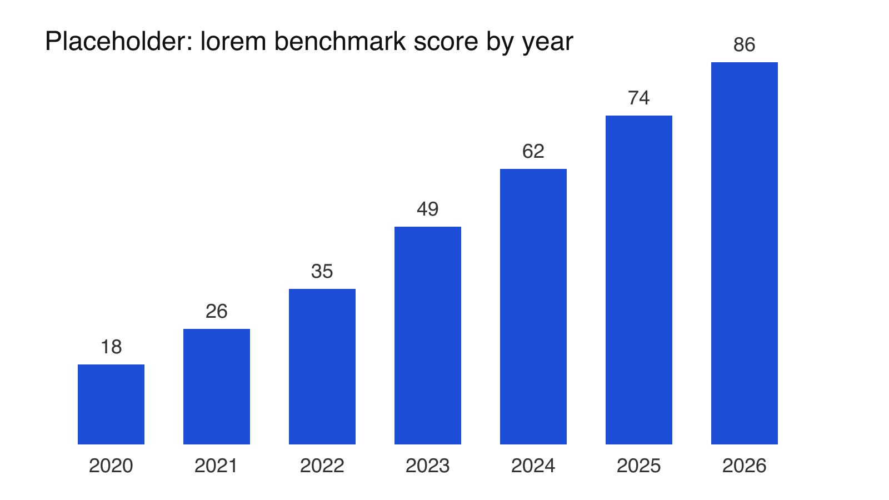

import Aside from '../../../widgets/Aside.astro';
import Flashcards from '../../../widgets/Flashcards.astro';

Lorem ipsum dolor sit amet, consectetur adipiscing elit. Sed do eiusmod tempor incididunt ut labore et dolore magna aliqua. Ut enim ad minim veniam, quis nostrud exercitation ullamco laboris.

## An image

Images live in the Post's folder.
The build fails if one has no alt text.

Duis aute irure dolor in reprehenderit in voluptate velit esse cillum dolore eu fugiat nulla pariatur.

## A flashcard Widget

<Flashcards
  title="Lorem flashcards"
  caption="Flip each card to check yourself."
  cards={[
    {
      front: 'Lorem ipsum dolor?',
      back: 'Sit amet, consectetur adipiscing elit.',
    },
    { front: 'Sed do eiusmod?', back: 'Tempor incididunt ut labore.' },
    { front: 'Ut enim ad minim?', back: 'Veniam, quis nostrud exercitation.' },
  ]}
/>

## An accordion with an aside

<Aside summary="Lorem aside: why this matters">

Excepteur sint occaecat cupidatat non proident.
Sunt in culpa qui officia deserunt mollit anim id est laborum.

</Aside>

Curabitur blandit tempus porttitor. Nullam quis risus eget urna mollis ornare vel eu leo.
